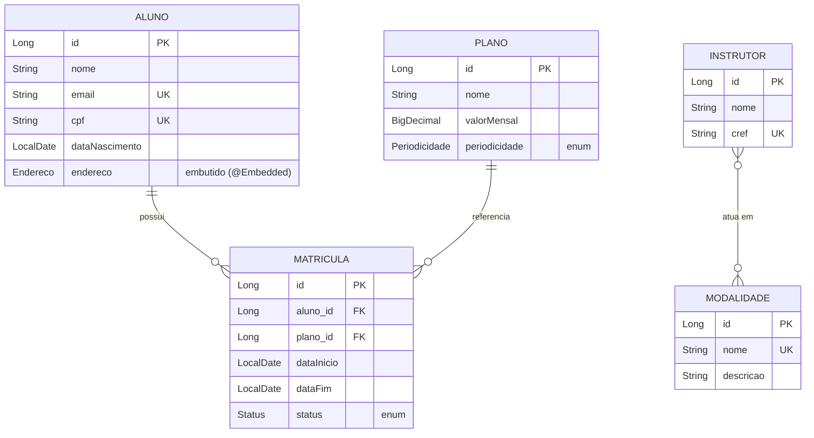

<h1 align="center">🏋️ Academia API — Spring Data JPA</h1>

<p align="center">
  API RESTful para o domínio de uma <strong>academia de ginástica</strong>,
  desenvolvida como desafio de projeto da <strong>DIO</strong> para praticar os
  principais conceitos de <strong>mapeamento objeto-relacional (ORM)</strong>
  com <strong>Spring Data JPA</strong>.
</p>

<p align="center">
  
  
  
  
  
  
  
</p>

---

## 📑 Sumário

- [Sobre o projeto](#-sobre-o-projeto)
- [Funcionalidades](#-funcionalidades)
- [Tecnologias](#-tecnologias)
- [Como executar](#-como-executar)
- [Documentação interativa (Swagger)](#-documentação-interativa-swagger)
- [Modelo de domínio](#-modelo-de-domínio)
- [Estrutura do projeto](#-estrutura-do-projeto)
- [Endpoints](#-endpoints)
- [Padrão de respostas HTTP](#-padrão-de-respostas-http)
- [Exemplos de requisição e resposta](#-exemplos-de-requisição-e-resposta)
- [Testando rápido com curl](#-testando-rápido-com-curl)
- [Conceitos de ORM aplicados](#-conceitos-de-orm-aplicados)
- [Consultas avançadas em detalhe](#-consultas-avançadas-em-detalhe)
- [Testes](#-testes)
- [Próximos passos](#-próximos-passos)

---

## 📖 Sobre o projeto

A API gerencia uma academia: **alunos** (com endereço), **planos** de
assinatura, **instrutores**, **modalidades** e as **matrículas** que ligam um
aluno a um plano. O objetivo é exercitar, na prática, todo o fluxo de ORM com
Spring Data JPA — da modelagem das entidades e seus relacionamentos até
consultas avançadas, validação e documentação de API.

O projeto cobre, em ordem, os tópicos do curso: configuração de banco, anotações
de entidades, CRUD, revisão, validação e consultas avançadas.

## ✨ Funcionalidades

- ✅ **CRUD completo** de 5 recursos: alunos, planos, modalidades, instrutores e matrículas.
- ✅ **Relacionamentos JPA** de todos os tipos (1:N, N:1, N:N e objeto embutido).
- ✅ **Validação** de entrada com Bean Validation e mensagens de erro padronizadas.
- ✅ **Consultas avançadas** com _query methods_ derivados e **JPQL** (`@Query`, `JOIN FETCH`, `GROUP BY`).
- ✅ **Paginação e ordenação** via `Pageable`.
- ✅ **Documentação OpenAPI/Swagger** interativa.
- ✅ **Tratamento global de exceções** (`@RestControllerAdvice`) com respostas HTTP consistentes.
- ✅ **Carga inicial de dados** (`data.sql`) para a API já subir com conteúdo de exemplo.
- ✅ **Testes de integração** com MockMvc (11 testes).

## 🛠 Tecnologias

- **Java 17**
- **Spring Boot 3.5.7** — Web, Data JPA, Validation
- **Hibernate** — implementação JPA
- **springdoc-openapi 2.8** — documentação OpenAPI + Swagger UI
- **Banco H2** em memória (sem instalação externa)
- **Maven** via **Maven Wrapper** (não precisa ter o Maven instalado)
- **JUnit 5 + MockMvc** — testes de integração

## 🚀 Como executar

> Pré-requisito: um **JDK 17** (ou superior) instalado e a variável `JAVA_HOME`
> apontando para ele.

```bash
# Windows
.\mvnw.cmd spring-boot:run

# Linux / macOS
./mvnw spring-boot:run
```

A API sobe em **`http://localhost:8080`**.

Empacotar o `.jar` executável e rodar os testes:

```bash
.\mvnw.cmd clean verify
java -jar target/academia-api-1.0.0.jar
```

O **console do H2** fica em `http://localhost:8080/h2-console`
(JDBC URL: `jdbc:h2:mem:academia`, usuário: `sa`, sem senha).

## 📚 Documentação interativa (Swagger)

Com a aplicação no ar:

| Recurso          | URL                                          |
|------------------|----------------------------------------------|
| **Swagger UI**   | http://localhost:8080/swagger-ui.html        |
| **OpenAPI JSON** | http://localhost:8080/v3/api-docs            |

Pela Swagger UI dá para explorar e disparar todas as requisições direto do
navegador.

## 🗂 Modelo de domínio



> `INSTRUTOR` e `MODALIDADE` se relacionam via a tabela de junção
> `instrutor_modalidade` (`@ManyToMany` + `@JoinTable`).

Relacionamentos JPA demonstrados:

| Relacionamento              | Onde                                        | Anotação                        |
|-----------------------------|---------------------------------------------|---------------------------------|
| One-to-Many / Many-to-One   | `Aluno` ↔ `Matricula`                       | `@OneToMany` / `@ManyToOne`     |
| Many-to-One                 | `Matricula` → `Plano`                       | `@ManyToOne`                    |
| Many-to-Many                | `Instrutor` ↔ `Modalidade`                  | `@ManyToMany` + `@JoinTable`    |
| Embutido                    | `Aluno` → `Endereco`                        | `@Embeddable` / `@Embedded`     |
| Enum persistido             | `Plano.periodicidade`, `Matricula.status`   | `@Enumerated(EnumType.STRING)`  |

## 📁 Estrutura do projeto

```
src/main/java/com/dio/academia
├── AcademiaApiApplication.java      # classe principal
├── config/                          # OpenApiConfig (Swagger)
├── domain/                          # entidades JPA (@Entity)
│   └── Aluno, Endereco, Instrutor, Matricula, Modalidade, Plano
├── repository/                      # Spring Data repositories (CRUD + queries)
├── dto/                             # records de request/response
├── service/                         # regras de negócio (@Service, @Transactional)
│   └── exception/                   # exceções de domínio
└── controller/                      # endpoints REST (@RestController)
    └── exception/                   # tratador global (@RestControllerAdvice)

src/test/java/com/dio/academia
├── AcademiaApiApplicationTests.java # smoke test (contexto sobe)
└── controller/                      # testes de integração (MockMvc)
```

## 🔌 Endpoints

### Alunos — `/api/alunos`

| Método | Rota                                        | Descrição                              |
|--------|---------------------------------------------|----------------------------------------|
| GET    | `/api/alunos`                               | Lista todos                            |
| GET    | `/api/alunos?nome=silva`                    | Filtra por trecho do nome              |
| GET    | `/api/alunos?ativos=true`                   | Apenas com matrícula ativa (JPQL)      |
| GET    | `/api/alunos/paginado?page=0&size=10&sort=nome,asc` | Lista **paginada** e ordenada  |
| GET    | `/api/alunos/{id}`                          | Busca por id                           |
| POST   | `/api/alunos`                               | Cria (201)                             |
| PUT    | `/api/alunos/{id}`                          | Atualiza                               |
| DELETE | `/api/alunos/{id}`                          | Exclui (204)                           |

### Planos — `/api/planos`

| Método | Rota                                   | Descrição                            |
|--------|----------------------------------------|--------------------------------------|
| GET    | `/api/planos`                          | Lista todos                          |
| GET    | `/api/planos?periodicidade=ANUAL`      | Filtra por periodicidade             |
| GET    | `/api/planos/{id}`                     | Busca por id                         |
| POST   | `/api/planos`                          | Cria (201)                           |
| PUT    | `/api/planos/{id}`                     | Atualiza                             |
| DELETE | `/api/planos/{id}`                     | Exclui (204)                         |

### Modalidades — `/api/modalidades`

| Método | Rota                        | Descrição               |
|--------|-----------------------------|-------------------------|
| GET    | `/api/modalidades`          | Lista todas             |
| GET    | `/api/modalidades/{id}`     | Busca por id            |
| POST   | `/api/modalidades`          | Cria (201)              |
| PUT    | `/api/modalidades/{id}`     | Atualiza                |
| DELETE | `/api/modalidades/{id}`     | Exclui (204)            |

### Instrutores — `/api/instrutores`

| Método | Rota                                      | Descrição                                  |
|--------|-------------------------------------------|--------------------------------------------|
| GET    | `/api/instrutores`                        | Lista todos (com suas modalidades)         |
| GET    | `/api/instrutores?modalidade=Spinning`    | Filtra por modalidade (JPQL ManyToMany)    |
| GET    | `/api/instrutores/{id}`                   | Busca por id                               |
| POST   | `/api/instrutores`                        | Cria e associa modalidades (201)           |
| PUT    | `/api/instrutores/{id}`                   | Atualiza (inclui as modalidades)           |
| DELETE | `/api/instrutores/{id}`                   | Exclui (204)                               |

### Matrículas — `/api/matriculas`

| Método | Rota                                   | Descrição                            |
|--------|----------------------------------------|--------------------------------------|
| GET    | `/api/matriculas`                      | Lista todas                          |
| GET    | `/api/matriculas?alunoId=1`            | Lista por aluno                      |
| GET    | `/api/matriculas/relatorio/por-plano`  | Contagem por plano (JPQL GROUP BY)   |
| POST   | `/api/matriculas`                      | Matricula aluno em plano (201)       |
| PATCH  | `/api/matriculas/{id}/status?status=`  | Altera o status                      |
| DELETE | `/api/matriculas/{id}`                 | Cancela/exclui                       |

Há um arquivo [`requests.http`](requests.http) com exemplos prontos para rodar
(extensão *REST Client* no VS Code).

## 📋 Padrão de respostas HTTP

| Código | Quando acontece                                             |
|--------|------------------------------------------------------------|
| `200 OK` | Consulta ou atualização bem-sucedida                     |
| `201 Created` | Recurso criado (com o header `Location` apontando para ele) |
| `204 No Content` | Exclusão bem-sucedida                             |
| `400 Bad Request` | Falha de validação (corpo detalha os campos)    |
| `404 Not Found` | Recurso inexistente                               |
| `409 Conflict` | Violação de regra de negócio (ex.: e-mail/CPF/CREF duplicado) |

As respostas de erro seguem sempre o mesmo formato, produzido pelo
`ApiExceptionHandler` (`@RestControllerAdvice`).

##  Exemplos de requisição e resposta

<details open>
<summary><strong>Criar aluno</strong> — <code>POST /api/alunos</code></summary>

**Request**

```json
{
  "nome": "Pedro Santos",
  "email": "pedro@email.com",
  "cpf": "333.333.333-33",
  "dataNascimento": "2000-05-20",
  "endereco": {
    "cep": "30110-000",
    "logradouro": "Av. Afonso Pena",
    "cidade": "Belo Horizonte",
    "uf": "MG"
  }
}
```

**Response — `201 Created`**

```json
{
  "id": 3,
  "nome": "Pedro Santos",
  "email": "pedro@email.com",
  "cpf": "333.333.333-33",
  "dataNascimento": "2000-05-20",
  "endereco": {
    "cep": "30110-000",
    "logradouro": "Av. Afonso Pena",
    "cidade": "Belo Horizonte",
    "uf": "MG"
  }
}
```

</details>

<details>
<summary><strong>Criar instrutor associando modalidades (ManyToMany)</strong> — <code>POST /api/instrutores</code></summary>

**Request**

```json
{
  "nome": "Bruno Lima",
  "cref": "CREF-55555-G/SP",
  "modalidadeIds": [1, 2]
}
```

**Response — `201 Created`**

```json
{
  "id": 3,
  "nome": "Bruno Lima",
  "cref": "CREF-55555-G/SP",
  "modalidades": [
    { "id": 1, "nome": "Musculacao", "descricao": "Treino de forca com pesos livres e maquinas" },
    { "id": 2, "nome": "Spinning",   "descricao": "Aula de ciclismo indoor de alta intensidade" }
  ]
}
```

</details>

<details>
<summary><strong>Listagem paginada</strong> — <code>GET /api/alunos/paginado?size=1&sort=nome,asc</code></summary>

**Response — `200 OK`**

```json
{
  "content": [
    { "id": 1, "nome": "Joao da Silva", "email": "joao@email.com" }
  ],
  "totalElements": 2,
  "totalPages": 2,
  "number": 0,
  "size": 1,
  "first": true,
  "last": false
}
```

</details>

<details>
<summary><strong>Relatório de matrículas por plano</strong> — <code>GET /api/matriculas/relatorio/por-plano</code></summary>

**Response — `200 OK`**

```json
[
  { "plano": "Anual Premium", "quantidade": 1 },
  { "plano": "Mensal Basico", "quantidade": 1 }
]
```

</details>

<details>
<summary><strong>Erro de validação</strong> — <code>400 Bad Request</code></summary>

```json
{
  "timestamp": "2026-11-02T18:33:29.109454Z",
  "status": 400,
  "error": "Bad Request",
  "message": "Erro de validacao nos campos enviados",
  "path": "/api/alunos",
  "campos": {
    "email": "E-mail invalido",
    "nome": "O nome e obrigatorio"
  }
}
```

</details>

## ⚡ Testando rápido com curl

Com a aplicação rodando em `http://localhost:8080`:

```bash
# Listar alunos
curl http://localhost:8080/api/alunos

# Apenas alunos com matrícula ativa (consulta JPQL)
curl "http://localhost:8080/api/alunos?ativos=true"

# Relatório de matrículas por plano (JPQL GROUP BY)
curl http://localhost:8080/api/matriculas/relatorio/por-plano

# Instrutores de uma modalidade (JPQL ManyToMany)
curl "http://localhost:8080/api/instrutores?modalidade=Spinning"

# Criar um aluno
curl -X POST http://localhost:8080/api/alunos \
  -H "Content-Type: application/json" \
  -d '{"nome":"Ana","email":"ana@email.com","cpf":"444.444.444-44","dataNascimento":"1997-07-07"}'
```

## 🧠 Conceitos de ORM aplicados

- **Configuração do banco** — `application.yml` com H2, `ddl-auto: create-drop`
  e carga inicial via `data.sql`.
- **Anotações de entidades** — `@Entity`, `@Table`, `@Id`, `@GeneratedValue`,
  `@Column`, `@Embedded`, `@Enumerated`, além de todos os relacionamentos acima.
- **CRUD** — fornecido pelos repositórios que estendem `JpaRepository` e exposto
  pelos controllers REST (5 recursos com CRUD completo).
- **Validação** — Bean Validation (`@NotBlank`, `@Email`, `@Past`, `@Positive`…)
  nas entidades e DTOs, com tratamento global de erros retornando os campos
  inválidos.
- **Consultas avançadas**
  - *query methods* derivados (`findByNomeContainingIgnoreCase`,
    `findByValorMensalLessThanEqualOrderByValorMensalAsc`);
  - *JPQL* com `@Query`, incluindo `JOIN FETCH` (evita N+1 /
    `LazyInitializationException`), navegação por relacionamentos e agregação
    com `GROUP BY`.
- **Paginação e ordenação** — `Pageable` / `Page<T>` em `/api/alunos/paginado`.
- **DTOs** — `records` de request/response desacoplam a API das entidades JPA.

## 🔎 Consultas avançadas em detalhe

O foco do desafio é ORM, então vale destacar as consultas escritas à mão.

**Query method derivado** — o Spring Data gera a consulta a partir do nome:

```java
// AlunoRepository
List<Aluno> findByNomeContainingIgnoreCase(String trecho);
```

**JPQL com `JOIN FETCH`** — carrega as matrículas junto com o aluno numa única
consulta, evitando o problema do N+1 e o `LazyInitializationException`:

```java
// AlunoRepository
@Query("SELECT a FROM Aluno a LEFT JOIN FETCH a.matriculas WHERE a.id = :id")
Optional<Aluno> buscarComMatriculas(@Param("id") Long id);
```

**JPQL navegando por relacionamento ManyToMany** — instrutores de uma modalidade:

```java
// InstrutorRepository
@Query("""
        SELECT DISTINCT i FROM Instrutor i
        JOIN i.modalidades m
        WHERE LOWER(m.nome) = LOWER(:nomeModalidade)
        """)
List<Instrutor> buscarPorModalidade(@Param("nomeModalidade") String nomeModalidade);
```

**JPQL com agregação (`GROUP BY`)** — relatório de matrículas por plano:

```java
// MatriculaRepository
@Query("""
        SELECT m.plano.nome, COUNT(m)
        FROM Matricula m
        GROUP BY m.plano.nome
        ORDER BY COUNT(m) DESC
        """)
List<Object[]> contarMatriculasPorPlano();
```

## 🧪 Testes

```bash
.\mvnw.cmd test        # só os testes
.\mvnw.cmd clean verify # build completo + testes + empacotamento
```

Cobertura atual:

- **Smoke test** — o contexto Spring sobe (valida mapeamentos JPA + seed).
- **`AlunoControllerIT`** — listagem, busca, 404, criação/exclusão, validação
  400 e paginação.
- **`InstrutorControllerIT`** — relacionamento ManyToMany: instrutor com
  modalidades, filtro por modalidade, criação associando modalidades e rejeição
  de modalidade inexistente.

## 🧭 Próximos passos

- [ ] Trocar o H2 por **PostgreSQL** (perfil `prod`) com Flyway para versionar o schema.
- [ ] Adicionar **autenticação** (Spring Security + JWT).
- [ ] Containerizar com **Docker** / `docker-compose`.
- [ ] Pipeline de **CI** (GitHub Actions) rodando `mvnw verify` a cada push.

---

<p align="center">
  Projeto educacional desenvolvido no desafio
  <a href="https://www.dio.me/">DIO — Conhecendo Spring Data JPA na prática com Java</a>.<br>
  O banco é <strong>em memória</strong>: os dados são recriados a cada
  inicialização a partir do <code>data.sql</code>.
</p>
